# Hub Monitoring Portal

> A real-time, full-stack internal tool for operations and customer success teams to monitor the health of Windows imaging agents ("Hubs") deployed at dental practices.


---

## Table of Contents

1. [Overview](#1-overview)
2. [Objectives](#2-objectives)
4. [Technology Stack](#4-technology-stack)
5. [System Architecture](#5-system-architecture)
6. [Backend Architecture](#6-backend-architecture)
7. [Frontend Architecture](#7-frontend-architecture)
8. [Agent Architecture](#8-agent-architecture)
9. [Database Schema](#9-database-schema)
10. [Data Storage Strategy](#10-data-storage-strategy)
11. [Data Flow and Workflows](#11-data-flow-and-workflows)
12. [Real-Time Communication Contract](#12-real-time-communication-contract)
13. [Features](#13-features)
14. [Authentication and Security](#14-authentication-and-security)
17. [CI/CD and Deployment](#17-cicd-and-deployment)
18. [Design Decisions and Trade-offs](#18-design-decisions-and-trade-offs)
19. [Issues Faced and Resolutions](#19-issues-faced-and-resolutions)
20. [Known Gaps](#20-known-gaps)
21. [Roadmap](#21-roadmap)
22. [Glossary](#22-glossary)

---

## 1. Overview

Each dental practice runs one or more **Hubs**: local Windows machines running the imaging software (**imaging software**) that captures X-rays and images and syncs them through a **local → server → AWS** pipeline.

Before this project there was no central way to know whether a Hub was online, whether imaging software was running, whether crashes were occurring, or whether images were syncing. The previous approach relied on a 4-hour polling cycle.

The **Hub Monitoring Portal** replaces that with a persistent, event-driven connection (SignalR) between every agent and a central backend, and a live dashboard for Ops and CSM teams.

The system is made of three independently deployed pieces:

| Component | Technology |
| --- | --- |
| **Agent** | .NET Framework 4.8 (Windows service / console app) |
| **Backend** | ASP.NET Core 8 (Web API + SignalR) |
| **Frontend** | Angular 21 (standalone components, signals) |

Questions the portal answers at a glance:

- Is a practice's hub agent online or offline right now?
- Is imaging software running on that machine?
- Has the imaging software crashed, and when?
- Are images syncing from local to server to AWS?
- Which incidents are still unresolved?

---

## 2. Objectives

- Real-time visibility into Hub connectivity and imaging software status.
- Centralised crash and incident reporting across all practices.
- Remote actions (kill imaging software, trigger update) without remote-desktop access to each machine.
- Image sync pipeline visibility (Local / Server / AWS) per Hub.
- Authenticated access with proper session management.
- Scale to hundreds of practices without excessive database load.

---

---

## 4. Technology Stack

| Layer | Technology |
| --- | --- |
| Agent | .NET Framework 4.8, SignalR Client 6.0.36, SQLite (local per-machine data) |
| Backend | ASP.NET Core 8 Web API, SignalR, SqlKata (query builder), MySqlConnector |
| Frontend | Angular 21: standalone components, Signals, `resource()`, Signal Forms, OnPush |
| Real-time | SignalR over WebSockets |
| Database | MariaDB 10.6 (portal), SQLite (per agent) |
| Migrations | Flyway (`V{yyyyMMddHHmm}__description.sql`) |
| Auth | Cookie-based session authentication (HttpOnly, encrypted), BCrypt password hashing |
| Config / secrets | AWS Secrets Manager (runtime-injected) |
| CI/CD | Docker, GitLab CI, AWS ECR, Kubernetes (Helm) |
| UI design | Figma Make, "the monitoring platform" dark theme |

---

## 5. System Architecture

### 5.1 High-level architecture

```mermaid
flowchart TB
    subgraph Practice["Dental Practice (per Hub machine)"]
        Agent["Agent Process<br/>.NET Framework 4.8"]
        SQLite[("Local SQLite<br/>Image / Session tables")]
        ImagingSoftware["Imaging Software"]
        EventLog["Windows Event Log"]
        Agent -->|reads| SQLite
        Agent -->|watches| EventLog
        Agent -.monitors.-> ImagingSoftware
    end

    subgraph Backend["Portal Backend (ASP.NET Core 8) on AWS"]
        ImagingHub["ImagingHub<br/>/imaginghub"]
        DashboardHub["DashboardHub<br/>/dashboardhub"]
        API["REST Controllers"]
        Registry[("AgentRegistry<br/>in-memory")]
        SyncStore[("ImageSyncStatsStore<br/>in-memory")]
        MariaDB[("MariaDB<br/>Hubs, HubSnapshots,<br/>Practices, Users")]
        Secrets["AWS Secrets Manager"]
        API --> MariaDB
        ImagingHub --> Registry
        ImagingHub --> SyncStore
        ImagingHub --> MariaDB
        Backend -.reads config.-> Secrets
    end

    subgraph Frontend["Angular 21 SPA (Browser)"]
        UI["Dashboard / Practices /<br/>Incidents / Hub Detail / Settings"]
    end

    Agent <==>|"persistent SignalR<br/>(outbound only)"| ImagingHub
    UI <==>|"persistent SignalR"| DashboardHub
    UI -->|"REST + session cookie"| API
    ImagingHub -->|"broadcast HubChanged"| DashboardHub
```

**Key architectural decisions**

- **Agents only make outbound connections.** Practice machines sit behind firewalls and NAT, so the backend never calls an agent directly over HTTP. Remote commands are pushed down the already-open SignalR connection.
- **Two separate SignalR hubs.** `ImagingHub` is agent-facing and write-heavy. `DashboardHub` is browser-facing and broadcast-only. Browser and agent traffic never mix.
- **REST plus push, no polling.** The frontend loads data via REST, then listens for `HubChanged` events to know *when* to refetch.
- **Config and secrets are injected at runtime.** `appsettings.json` ships empty; connection strings and CORS origins are pulled from AWS Secrets Manager at startup.
- **Live state is in memory.** Operation status and "is imaging software running" change every 30 seconds, so they are not written to the database.

### 5.2 Communication capabilities

| Direction | Purpose | Latency goal |
| --- | --- | --- |
| Agent → Server | Heartbeats, connectivity status, crash data | < 1 second |
| Server → Agent | Control signals (kill imaging software, trigger update, request image sync history) | < 1 second |
| Bidirectional | Acknowledgements | Real-time |

---

## 6. Backend Architecture

Layering: **Controllers / Hubs → Services → Repositories (SqlKata + MariaDB)**

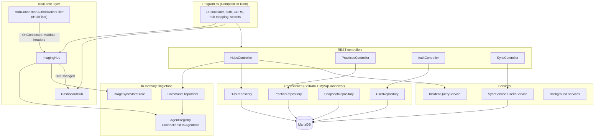

### 6.1 Key services

| Service | Purpose |
| --- | --- |
| `AgentRegistry` | In-memory map of currently connected agents (ConnectionId ↔ Practice/Hub). Singleton. |
| `CommandDispatcher` | Generic mechanism to push a named command to one specific connected agent. |
| `ImageSyncStatsStore` | In-memory cache of the latest image sync counts reported by each hub. |
| `IncidentQueryService` | Orchestrates SQL + in-memory filtering and grouping for the Incidents page. |
| `HubRepository` / `SnapshotRepository` / `PracticeRepository` / `UserRepository` | SqlKata data access to MariaDB. |
| `SyncService` / `DeltaService` | Pull practices and hubs from the source the source imaging database database; full or delta (changed records only). |

### 6.2 Why SqlKata

A fluent query builder was chosen over an ORM such as EF Core. Dapper was evaluated and rejected for consistency. For the batched multi-row upsert in `SyncService`, the code drops to `MySqlCommand` with explicitly named `@p{i}` parameters, because SqlKata's batch insert abstraction failed on parameter binding.

### 6.3 Agent authentication (SignalR hub filter)

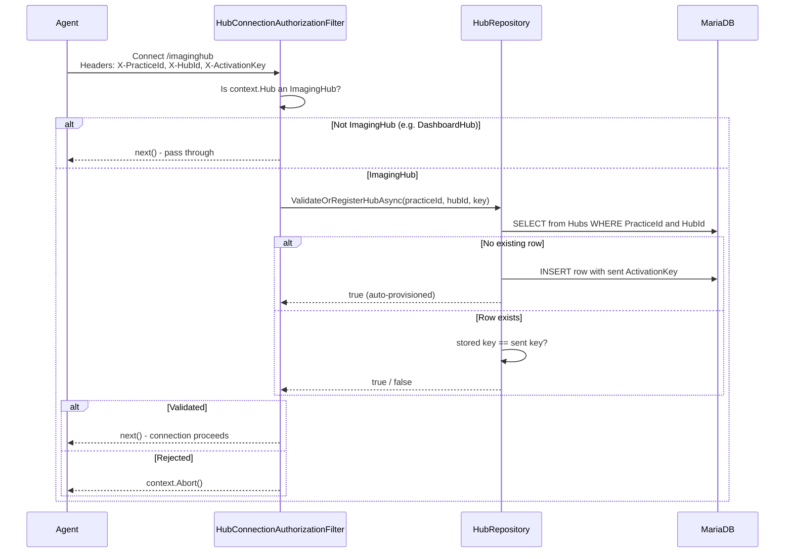

---

## 7. Frontend Architecture

Angular 21 with **standalone components**, **Signals**, `resource()`, **OnPush** change detection and `withComponentInputBinding()`.

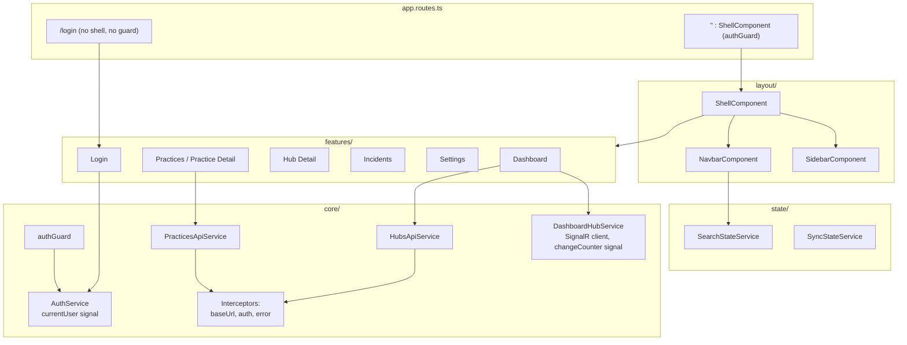

### 7.1 Reactive state pattern

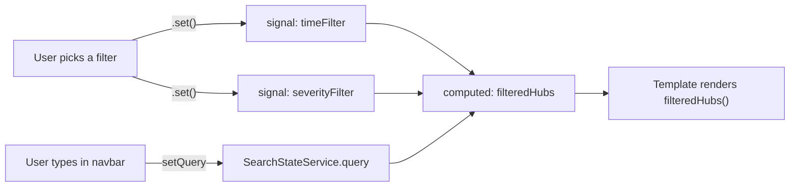

`computed()` tracks dependencies automatically and recalculates lazily, so only affected values recompute.

### 7.2 HTTP interceptors

| Interceptor | Responsibility |
| --- | --- |
| `baseUrlInterceptor` | Prefixes request URLs with the API base URL |
| `authInterceptor` | Adds `withCredentials: true` so the session cookie is sent cross-origin |
| `errorInterceptor` | Force-logs-out and redirects on any 401 |

### 7.3 Other patterns

- **Infinite scroll** via a reusable `InfiniteScrollDirective` (IntersectionObserver), used on Dashboard, Practices and Incidents.
- **Shared components:** `HubCard`, `KpiCard`, `StatusPill`, `IssuePill`, `ResolutionTag`, `BackButton`, `TrendChart`.
- **Optimistic UI** when toggling incidents resolved/unresolved.
- **Signal Forms** (experimental API) for the login form.

### 7.4 Route guard flow

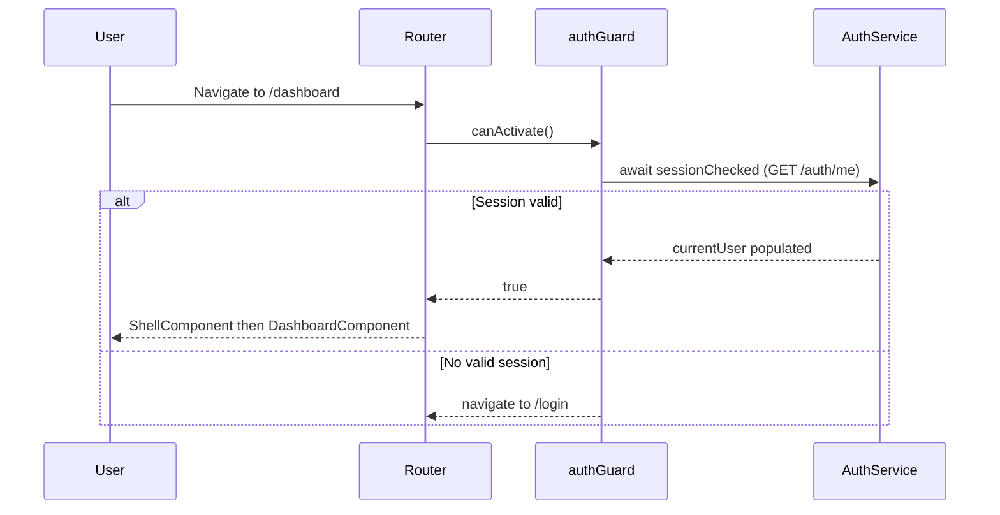

---

## 8. Agent Architecture

The agent is a .NET Framework 4.8 process installed on each Hub machine.

**Responsibilities**

- Maintain a persistent SignalR connection to `/imaginghub`.
- Send a heartbeat every 30 seconds (first one after a 10-second delay), including whether imaging software is running.
- Watch the Windows Event Log for imaging software crashes (`EventViewerWatcher`, filtered strictly to `EventId 1026`).
- Execute server-pushed commands: `KillIaq`, `TriggerUpdate`, `RequestImageSyncHistory`.
- Read its local SQLite database (`Image` joined to `Session`) to compute image sync counts.
- Run background services (upgrade check, image cleanup, session cleanup, log upload).

**Startup**

1. `Program.Main()` registers global exception handlers first (`AppDomain.UnhandledException`, `TaskScheduler.UnobservedTaskException`).
2. Builds the DI container and starts background services.
3. `AgentMonitoringService.StartAsync()` reads config, opens the SignalR connection, registers command listeners, starts the event watcher and the heartbeat timer.

**Resilience design**

| Mechanism | Purpose |
| --- | --- |
| `.WithAutomaticReconnect()` (0s, 2s, 5s, 15s, 30s) | Handles short network blips |
| `ManualReconnectLoopAsync()` (5s, 10s, 20s, capped at 2 min) | Takes over after built-in reconnect is exhausted; retries indefinitely |
| Bounded `ConcurrentQueue<HubHealthData>` (max 50) | Buffers health data while disconnected; flushed on reconnect |
| `_isStopping` flag | Distinguishes deliberate shutdown from unexpected disconnect |

### 8.1 Reconnection flow

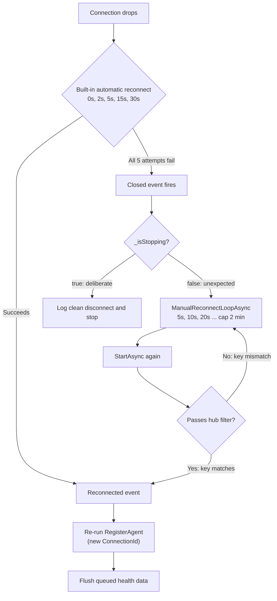

---

## 9. Database Schema

### 9.1 Entity relationship diagram

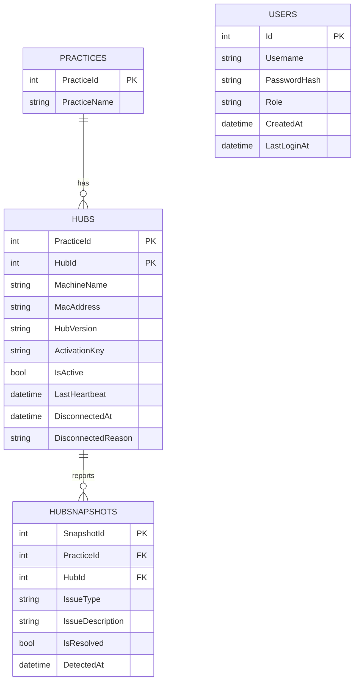

> `USERS` is standalone (login accounts only). Exact column types and the `SnapshotId`/`Id` key names should be confirmed against the Flyway migrations.

### 9.2 Tables

| Table | Key columns | Notes |
| --- | --- | --- |
| `Practices` | `PracticeId`, `PracticeName` | Reference data, synced from the source the source imaging database DB |
| `Hubs` | `PracticeId`, `HubId` (composite), `MachineName`, `MacAddress`, `HubVersion`, `ActivationKey`, `IsActive`, `LastHeartbeat`, `DisconnectedAt`, `DisconnectedReason` | One row per agent install |
| `HubSnapshots` | `PracticeId`, `HubId`, `IssueType`, `IssueDescription`, `IsResolved`, `DetectedAt` | Crash and issue records |
| `Users` | `Username`, `PasswordHash` (BCrypt), `Role`, `CreatedAt`, `LastLoginAt` | Login accounts |

**Deliberately not persisted:** `OperationStatus` and `IsIaqRunning`. They change every 30 seconds, so they live only in `AgentRegistry` and are merged into `HubDto` at read time.

### 9.3 Migrations

Flyway migrations follow `V{yyyyMMddHHmm}__description.sql`. Flyway records applied scripts in `flyway_schema_history`.

---

## 10. Data Storage Strategy

| Data | Stored in | Why |
| --- | --- | --- |
| Practice / Hub identity, crash snapshots | MariaDB | Persistent, low write frequency |
| Live connection status, imaging software running state | In-memory `AgentRegistry` | Avoids a DB write per heartbeat at scale |
| Image sync history cache | In-memory `ImageSyncStatsStore` | Simple and fast; agents re-report on demand |
| Session / auth state | Encrypted HttpOnly cookie | No server-side session store needed |
| Per-agent local data | SQLite (`aekaimaging.db`) on each machine | Local to each Hub, not replicated |

**Trade-off accepted:** anything held only in memory is lost on a backend restart. Agents reconnect and re-register automatically; cached image sync history returns after the next refresh.

---

## 11. Data Flow and Workflows

### 11.1 End-to-end data flow

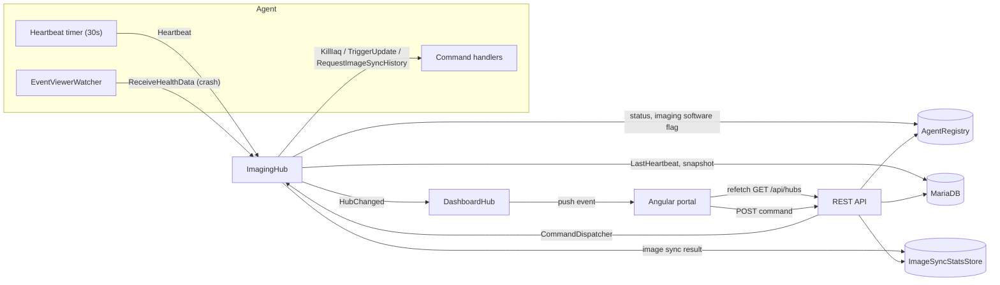

### 11.2 Agent startup and registration

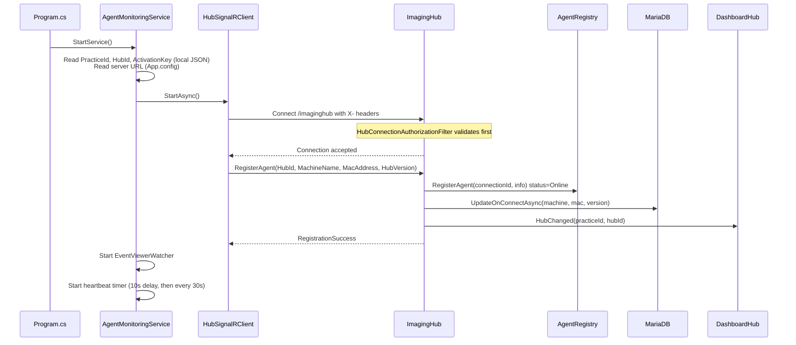

### 11.3 Heartbeat loop

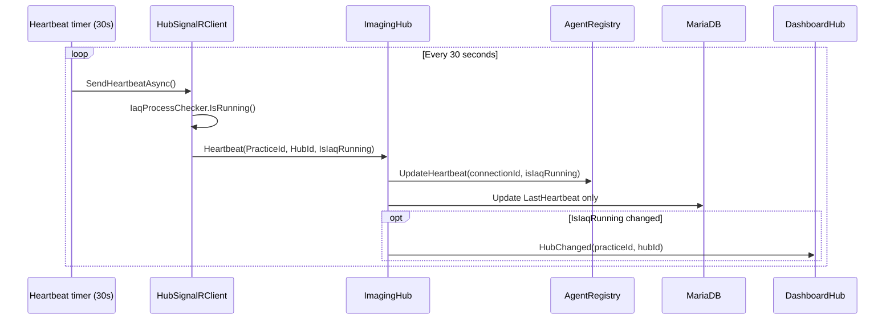

### 11.4 Crash detection and reporting

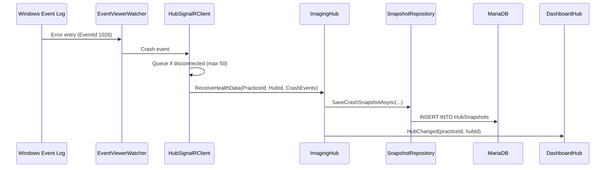

### 11.5 Live dashboard update (no polling)

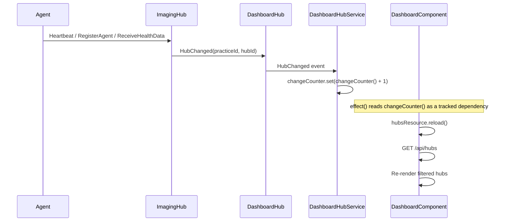

### 11.6 Remote command dispatch (Kill imaging software / Trigger Update)

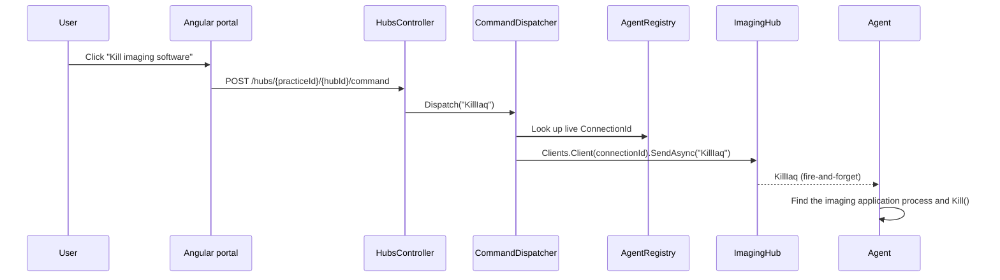

### 11.7 Image sync history (request, then report)

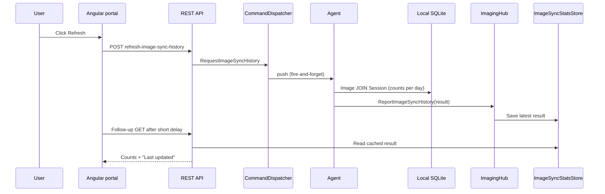

### 11.8 Login and session

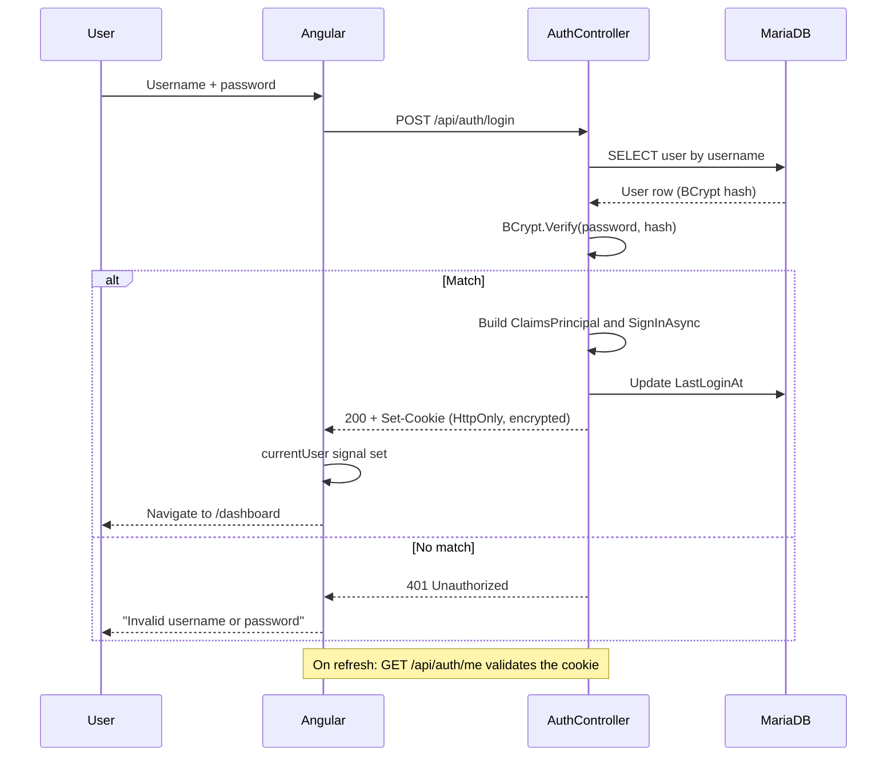

### 11.9 Source-data sync (Settings page)

`SyncService` pulls practices and hubs from the source the source imaging database database into the portal database.

- **Full sync:** pulls all practices and hubs.
- **Delta sync:** pulls only records changed since the last run (`DeltaService`).
- Sync state is stored in a state file (see [Known Gaps](#20-known-gaps) for the container persistence caveat).

---

## 12. Real-Time Communication Contract

### 12.1 Hubs

| Hub | Path | Used by | Purpose |
| --- | --- | --- | --- |
| `ImagingHub` | `/imaginghub` | Agents | Registration, heartbeats, crash reports, targeted commands |
| `DashboardHub` | `/dashboardhub` | Browsers | Broadcast-only `HubChanged` notifications |

### 12.2 Agent → Server (invocations on `ImagingHub`)

| Method | Payload | Effect |
| --- | --- | --- |
| `RegisterAgent` | `HubId, MachineName, MacAddress, HubVersion` | Adds to `AgentRegistry`, updates `Hubs`, broadcasts `HubChanged` |
| `Heartbeat` | `PracticeId, HubId, IsIaqRunning` | Updates registry and `LastHeartbeat`; broadcasts if imaging software state changed |
| `ReceiveHealthData` | `PracticeId, HubId, CrashEvents` | Inserts into `HubSnapshots`; broadcasts `HubChanged` |
| `ReportImageSyncHistory` | per-day Local / Server / AWS counts | Stored in `ImageSyncStatsStore` |

### 12.3 Server → Agent (pushed commands)

| Command | Effect on agent |
| --- | --- |
| `KillIaq` | Finds and kills the the imaging application process |
| `TriggerUpdate` | Starts the agent/imaging software update flow |
| `RequestImageSyncHistory` | Recomputes image sync counts and reports them back |

### 12.4 Server → Browser

| Event | Payload | Effect |
| --- | --- | --- |
| `HubChanged` | `practiceId, hubId` | Frontend increments `changeCounter`, triggering a REST refetch |

### 12.5 Agent connection headers

| Header | Meaning |
| --- | --- |
| `X-PracticeId` | Practice the hub belongs to |
| `X-HubId` | Hub identifier |
| `X-ActivationKey` | Key validated against the `Hubs` row |

### 12.6 Health classification

Hubs are classified from the last heartbeat time: **Online**, **Warning** (degraded) and **Offline / Not Responding** (heartbeat lost).

---

## 13. Features

### Dashboard
- Live table of all hubs: status, machine name, crash count, last heartbeat.
- KPI cards (Unresolved, Not Responding, Warning, Online), each clickable to apply a matching filter.
- Server-side pagination with infinite scroll (25 hubs per page).
- Server-side filters: Severity (Critical / Warning / Online) and Timeline.

### Practices
- Per-practice summary: total hubs, online / offline counts, crash count.
- Server-side pagination and search.
- **Practice detail:** per-practice hub table with clickable KPI cards (Crashes / Not Responding / Online / Total Hubs).

### Incidents
- Grouped-by-practice cards.
- Filters: Issue Type (App Crash, Service Failure, Runtime Exception, Disk Space Critical), Status (Unresolved / Resolved), Hub status.
- Pagination at the practice-group level to preserve the grouped UI.
- Optimistic resolve / unresolve.

### Hub Detail
- Connection metadata: machine name, MAC address, imaging software version, registered time, last heartbeat, disconnect time and reason, total crashes.
- Recent events with a **View payload** modal showing the raw crash details.
- **Remote actions:** Kill imaging software, Trigger Update.
- **Image Sync History:** on-demand per-day counts in Local / Server / AWS, with a "Last updated" timestamp and Refresh button.

### Settings
- Data sync status, last sync time, mode (delta or full).
- **Run delta sync** and **Force full sync** buttons.

### Global
- Search across hubs, practices and machines.
- Last-sync indicator and manual refresh in the navbar.

---

## 14. Authentication and Security

**Implemented**

- Encrypted, **HttpOnly** session cookies (not readable by JavaScript, so resistant to XSS token theft).
- `[Authorize]` enforced on data-serving controllers.
- **BCrypt** password hashing (hash embeds salt and cost factor).
- CORS restricted to named origins (no wildcard), required for credentialed cross-origin cookies.
- Environment-aware cookie policy: `SameAsRequest` in Development, `Always` in Production.
- Global 401 handling in the frontend (`errorInterceptor`).
- Agent hub filter validates `X-PracticeId`, `X-HubId` and `X-ActivationKey` before any `ImagingHub` connection proceeds.
- Secrets pulled from AWS Secrets Manager at runtime.

**Middleware order matters:** `UseAuthentication` must come before `UseAuthorization`.

---

---

---

## 17. CI/CD and Deployment

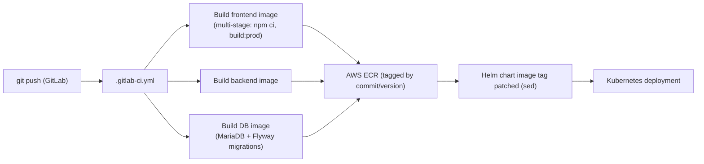

- Frontend Dockerfile is multi-stage: builds the Angular app, then copies the compiled output into a lean serving image.
- The container's app directory is read-only; temp paths are used for writable state.

---

## 18. Design Decisions and Trade-offs

| Decision | Reason | Consequence |
| --- | --- | --- |
| SignalR instead of 4-hour polling | Near-instant status and crash visibility | Requires persistent connections |
| Agents connect outbound only | Firewalls and NAT at practice sites | Remote actions must be pushed down SignalR |
| Two hubs (agent vs browser) | Separate concerns and traffic profiles | Slightly more wiring |
| Hub status in memory, not DB | Avoid hundreds of hubs × 30s writes | No SQL-only filtering by live status; **hybrid** fetch, merge and filter in C# |
| Incident pagination by practice group | Matches the grouped UI | Page size is groups, not rows |
| Fire-and-forget commands | Agent SignalR client is 6.0.36 (client results need 7.0+) | Image sync history uses request, then report, then delayed read |
| SqlKata over an ORM | Lightweight, explicit SQL | Raw `MySqlCommand` used for batch upsert |
| HttpOnly cookie auth | Resist XSS token theft | Needs CORS with credentials and CSRF consideration |
| Signals + OnPush | Fine-grained reactivity, less RxJS plumbing | Uses experimental Signal Forms for login |

---

## 19. Issues Faced and Resolutions

| # | Issue | Root cause | Resolution |
| --- | --- | --- | --- |
| 1 | Agent state file write failure | Read-only container filesystem | Route state file to `Path.GetTempPath()` |
| 2 | Flyway scripts failing silently | Missing line breaks between statements | Added explicit line breaks and delimiters |
| 3 | SqlKata batch upsert failing | Parameter binding mismatch | Raw `MySqlCommand` with named `@p{i}` parameters |
| 4 | `IsIaqRunning` always false | Missing `.Select()` column | Added the column |
| 5 | Heartbeat timestamps not persisting | Update method never called | Wired into heartbeat handler |
| 6 | `KillIaq` / `TriggerUpdate` doing nothing | Handler argument-count mismatch | Typed `Func<>` so the right overload is chosen |
| 7 | Agent not picking up new handlers | Stale running process | Stop process fully before rebuild |
| 8 | 401 on imaging software update download | External QA server auth issue | Isolated as out of scope |
| 9 | Cookie not set locally | `CookieSecurePolicy.Always` on HTTP | `SameAsRequest` in Development |
| 10 | Refresh bounced to login | Guard ran before async session check | Guard awaits `sessionChecked` |
| 11 | Image sync request hung | SignalR client 6.0.36 lacks client results | Two fire-and-forget messages |
| 12 | 404 on a planned endpoint | Endpoint never added to controller | Added the method |
| 13 | NullReferenceException in controller | Field never injected via constructor | Added constructor parameter |
| 14 | CryptographicException (invalid padding) | Unrelated image-upload feature, stale key | Isolated as separate issue |
| 15 | Signal Forms class conflict | `[formField]` plus manual `[disabled]` | Moved logic into form schema |
| 16 | Duplicate crash snapshots | Multiple event IDs matched | Filter strictly to `EventId 1026` |
| 17 | SignalR 401 in dev | QA URL pointed at a remote server | Corrected `MonitoringServerQAUrl` |
| 18 | Type mismatch on `PracticeId` / `HubId` | `int` vs `string` inconsistency | Unified types in `HubHealthData` |

---

## 20. Known Gaps

| Area | Current state | Production needs |
| --- | --- | --- |
| Agent first-connect trust | First connection for a new `PracticeId` + `HubId` is auto-provisioned | Pre-provisioned hub registry with admin-issued keys |
| Reconnect vs. rejection | Manual loop retries forever, treating network failure and rejected credentials the same | Distinct close reason so rejected hubs stop and raise an alert |
| CSRF | No CSRF token scheme; `SameSite=None` needed for cross-origin dev | CSRF mitigation on state-changing endpoints |
| Command dispatch | `/hubs/{p}/{h}/command` forwards any string to the agent | Allow-list of valid commands |
| Users | Single seeded admin account; schema supports more | Per-person accounts and roles |
| Sync state file | Written to temp directory in the container | Persistent mounted volume |
| In-memory stores | `AgentRegistry` and `ImageSyncStatsStore` lost on restart | Redis-backed registry if scaling beyond one instance |
| Incident types | Only App Crash has real detection | Implement Service Failure, Runtime Exception, Disk Space Critical |

---

## 21. Roadmap

**Near term**

- Allow-list validation for dispatched commands.
- CSRF mitigation.
- Real detection logic for the remaining incident types.
- Unit tests, request debouncing, multi-user accounts.
- Upgrade the agent's SignalR client to 7.0+ to enable true request/response.

**Original design: eight monitoring categories** (modular plugin design: each category is an `IHeartbeatModule` on the agent, with a matching `IModuleProcessor` behind a module router on the backend)

1. Hub usage tracking
2. Image sync failures
3. Disk space with projections
4. Imaging device disconnection detection
5. Network quality
6. Windows OS health
7. Last-known-state capture
8. the monitoring platform spec compliance

**Planned three-tier storage** (not yet implemented; the current build uses MariaDB only)

| Tier | Technology | Purpose |
| --- | --- | --- |
| Hot | Current-state table | Fast dashboard lookups |
| Warm | Time-series store | Trend charts, recent incident analysis |
| Cold | S3 / Parquet | Long-term archive |

**Scaling options explored:** Azure SignalR Service, Redis-backed `AgentRegistry`.

---

## 22. Glossary

| Term | Meaning |
| --- | --- |
| **Hub** | A Windows machine at a practice running the agent and imaging software |
| **imaging software** | The imaging acquisition software monitored by the agent |
| **Agent** | The .NET 4.8 process that reports health and executes commands |
| **CSM** | Customer Success Manager |
| **Signal / Computed** | Angular reactive primitives; computed values are derived, cached and auto-tracked |
| **BCrypt cost factor** | Hash rounds as 2^n; higher is slower and more brute-force resistant |
| **IHubFilter** | SignalR's equivalent of an MVC action filter for hub lifecycle events |
| **Flyway** | Versioned SQL migration tool |
| **SqlKata** | Fluent SQL query builder for .NET |
| **Fire-and-forget** | Send a message without awaiting a return value |
| **HttpOnly cookie** | Cookie the browser sends automatically but JavaScript cannot read |

---

*Internal monitoring platform.*
